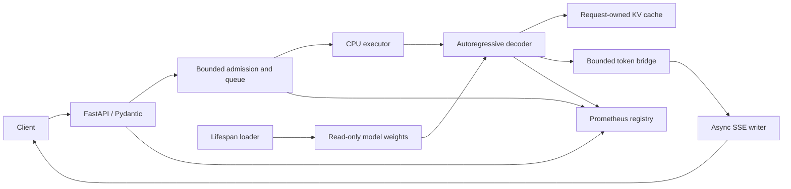

# Architecture

## Target runtime (planned)

The application lifespan loads a tokenizer and CPU model from an explicit local
directory. Loading fails closed on missing or unsupported assets. It never fetches
weights or executes model-supplied Python. Readiness becomes true after loading
and a small validation forward pass; health reports process liveness separately.
Shutdown stops admission, cancels outstanding work, drains workers and frees weights.

Initial execution uses one dedicated CPU worker, a configurable finite queue and
fixed PyTorch intra-op threads. This bounds decoding pressure without multiplying
model memory. Increasing active workers requires memory/load measurements and
verification that the chosen model supports concurrent forwards. Use one ASGI
worker per model instance: multiple worker processes each own separate weights.

Tokenization and decoding run outside the event loop. An asyncio semaphore alone
does not bound waiting requests: admission explicitly tracks both active and queued
jobs. Cancellation of an asyncio future does not stop its CPU thread. Each job has
a thread-safe cancellation event and monotonic deadline checked between steps;
capacity is released only after the worker actually exits. A running PyTorch
operation cannot be preempted: deadline overshoot is bounded by a forward step and
cleanup, not guaranteed hard real-time. Hard deadlines require process isolation.

## Module ownership

| Module | Responsibility | Phase |
| --- | --- | --- |
| `contracts.py` | Typed baseline requests, configuration and measurements | 1 |
| `loader.py` | Local-only CPU model/tokenizer loading | 1; lifespan integration 2 |
| `decoder.py` | Baseline greedy backend invocation, later custom token loop | 1, 2 |
| `mock.py` | Explicit deterministic synthetic backend | 1 |
| `baseline.py` | Intentionally load weights for every CLI request | 1 |
| `benchmark.py` | Raw samples, summaries, reproducible measurement metadata | 1+ |
| `app.py`, `schemas.py` | FastAPI lifespan/routes and Pydantic wire schemas | 2 |
| `streaming.py` | SSE framing, bounded bridge and disconnect cleanup | 3 |
| `cache.py` | Per-job cache lifecycle and position handling | 4 |
| `scheduling.py` | Admission, queue, deadlines and cancellation | 5 |
| `metrics.py` | Prometheus registry and instrumentation | 5 |

The baseline deliberately reloads weights and recomputes the full prefix with
`use_cache=False`. It uses Transformers' greedy `generate` as the reference;
phase 2 introduces our own autoregressive loop. No production path will call the
baseline. Model weights may be shared as read-only state; mutable token buffers,
RNG generators, attention masks, positions and KV caches belong to each job.

## Decoding and cache correctness

The custom loop performs prefill followed by one step per generated token, emits
only new tokens, and stops on EOS, output budget, cancellation or deadline. Greedy
decoding uses argmax; sampling later validates temperature, top-p and top-k and
uses a per-request RNG. Cache-off runs the complete prefix each step. Cache-on
runs the prompt once, then the latest token with the correct mask and position.
Never reuse a request's mutable cache for another request.

KV caching avoids repeating previous key/value projections and much prefix
computation. Attention still reads a growing history; inference is not generally
linear-time. Memory grows with layers, heads, sequence length, dtype and active
requests. Admission must account for both weights and worst-case cache memory.

## Proposed HTTP contract (not implemented in phase 1)

| Endpoint | Behavior |
| --- | --- |
| `POST /v1/generate` | Typed request; JSON text, finish reason, token usage and timings |
| `POST /v1/generate/stream` | Same request; incremental `token`, terminal `done` or `error` SSE |
| `GET /health` | Liveness without a model inference |
| `GET /ready` | 200 after model initialization; 503 while unavailable/draining |
| `GET /metrics` | Prometheus text exposition |

Requests will contain `prompt`, `max_new_tokens`, `stream`-independent sampling
options, and a bounded deadline. Service configuration supplies hard caps. Token
validation occurs after tokenization and before admission to generation, with
`input_tokens + max_new_tokens <= context_limit`. Validate body size before
expensive tokenization. Planned errors: 422 invalid budgets/options, 429 saturated
admission (with retry guidance), 503 unavailable, 504 elapsed deadline. Once SSE
headers are sent, errors use a terminal SSE event rather than changing HTTP status.

SSE carries JSON data with proper blank-line delimiters. Incremental detokenization
handles split UTF-8/subword boundaries rather than decoding each token independently.
A bounded bridge applies backpressure; a slow or disconnected client cannot retain
unbounded tokens. Heartbeats are independent of model progress. Abort signals
unblock both bridge producer and consumer. Cleanup executes in `finally` paths.

## Metrics and measurement

Track load duration; request, queue and generation latency; time to first token;
generated tokens; active/waiting jobs; rejection, failure and cancellation counts.
Use bounded labels (route, backend, status, finish reason), never prompt text.
Resource observations include CPU/thread configuration and peak RSS when supported.

Benchmark cases distinguish fresh-process startup, resident-model warm inference,
and concurrent admission/load. Keep raw samples and failures, calculate explicitly
defined percentiles, and compare matching prompts, model assets, output lengths,
thread counts and hardware. HTTP streaming measurements later use HTTPX and measure
first event, completion, disconnect behavior and actual received token counts.
